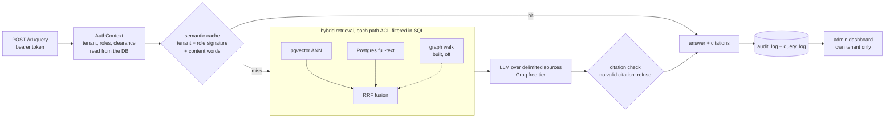

# Gateway

A multi-tenant RAG assistant for firms whose documents are not all for everyone: law, accounting, healthcare,
insurance. Every chunk carries its tenant, the roles allowed to read it and a clearance level, and **every retrieval
path filters on them inside Postgres**, so an intern's question can never retrieve the salary bands. Answers cite
the chunks they use and are refused when no valid citation supports them; every query is audited.

It runs on a $0 budget: local embeddings, free-tier LLMs, self-hosted Postgres. The corpus is synthetic (two
fictional firms, 50 documents); no real client data has been sent to any endpoint.

**Every number in this README is measured, and the negative results are reported with the same weight as the
positive ones.** Each row cites the section of [`EVAL_RESULTS.md`](EVAL_RESULTS.md) it comes from; the one-page
version is [`RESULTS_SUMMARY.md`](RESULTS_SUMMARY.md). Expectations were written down and committed before the run
that tested them.

## What it does

- **Permission-aware retrieval.** One ACL predicate (`gateway/security/acl.py`) is composed into the SQL `WHERE`
  clause of every path that reads chunks: vector (pgvector), keyword (Postgres full-text) and graph. Nothing is
  filtered in Python after retrieval.
- **Cited answers or a refusal.** The model answers from delimited sources and must cite them; a deterministic check
  refuses any answer with no valid citation.
- **Audit and metrics.** `audit_log` records what reached the model for whom; `query_log` records latency, tier,
  cache use and shadow cost.
- **Tenant-scoped semantic cache**, keyed on tenant + role signature + the question's content words; any document
  or ACL change wipes the tenant's entries.
- **Hybrid retrieval** (vector + full-text, fused with Reciprocal Rank Fusion).
- **Built, measured, and shipped off:** complexity routing to a larger model, and a GraphRAG layer. Both lost on
  this corpus; the numbers are below.
- **Chat page** (`/chat`) for the person asking: sign in, ask, read the answer with its sources (document and
  section). A refusal is shown exactly as the API returns it.
- **Admin dashboard** (HTMX + Chart.js, no build step), scoped to the admin's own tenant.

## Architecture



Postgres 17 + pgvector is the only store: vectors, full-text, graph, cache, audit and metrics. Redis is in the stack
for background jobs, but nothing uses it yet beyond a health check. Embeddings run locally (`BAAI/bge-small-en-v1.5`
via fastembed).

## Metrics

Shipped configuration: hybrid retrieval, cache on, routing off, graph off. Golden set: 100 questions (85
answerable, 15 unanswerable), each asked as a real seeded user with that user's permissions. Generator
`openai/gpt-oss-20b`, judge `openai/gpt-oss-120b`.

| Measure | Result | Previous phase | Source (`EVAL_RESULTS.md`) |
|---|---|---|---|
| Correct, answerable questions (judged) | **80 / 85** | 75 / 85 | Golden set baseline — Phase 5 |
| Multi-hop correct | **21 / 25** | 18 / 25 | Phase 5 gate: results |
| Single-hop correct | **49 / 50** | 47 / 50 | Phase 5 gate: results |
| False refusals (answerable refused) | **0** | 4 | Phase 5 gate: results |
| Faithful answers | 83 / 84 | 79 / 80 | Golden set baseline — Phase 5 |
| **Unanswerable questions refused** | **14 / 15** (one hallucination, q090) | 15 / 15 | Phase 5 headline finding |
| **Citations supported** | **0.869** (73 / 84) | 0.925 | Phase 5 headline finding |
| Isolation tests (ACL, admin, cache, dashboard, chat), together | **555 / 555** | — | Phase 6 scope added beyond the spec: `/chat` |
| Each retrieval path live, and leaking when its own predicate is removed (37 probes) | vector 37 / 37, keyword 36 / 37 and 37 / 37, graph 37 / 37 | — | Isolation suites: a false pass found and closed |
| Restricted chunks that reached the model before ACLs (Phase 2) vs after (Phase 3) | 187 → **0** | — | A correct answer that should never have been possible |
| Cache, repeated traffic (250 requests) | **57.2 %** hit, **54.9 %** shadow cost saved, as predicted | — | Phase 4 gate: results |
| Cache, paraphrased questions | **0 / 25** hit at every threshold (the price of the content-word check) | — | Phase 4 cache threshold sweep: results |
| Routing to the larger model | **off**: 22 / 25 correct vs 24 / 25 for the small model, at 1.94× the cost | — | Phase 4 routing: results |
| GraphRAG layer | **off**: multi-hop all-hops@6 9 / 25 with it vs 14 / 25 without | — | Phase 5 M2 (GraphRAG): the graph layer did not help |
| Money spent | **$0** (free tier); graph extraction would cost USD 0.057 at list price | — | Phase 5 M2 (GraphRAG): the graph layer did not help |

**What the table does not show on its own:**

- **The Phase 5 gain has a cost.** Hybrid retrieval produced the project's first hallucination on an unanswerable
  question: asked which law firm represents a client, the system named a person listed as legal counsel in a related
  agreement, with a real, permitted, on-topic citation. The citation check verifies that a cited chunk exists, is
  permitted and supports the sentence; here all three held, and the answer was still wrong. For an internal assistant
  in a law firm, 3 more correct answers against 1 confident wrong one is probably a bad trade. It ships as measured.
- **The graph reached every hop it needed** (16 of 16 within two steps) and still failed: hub entities ("Acme" is on
  50 of its firm's 133 chunks) make the reachable set so large that the graph's candidate list is near-arbitrary.
  Traversal recall was not the binding constraint; ranking was.
- **A green test suite once proved nothing.** The isolation suites passed while the graph modes walked an empty graph.
  Every isolation suite must now show that its path returns data and leaks when its own filter is removed.
- **The judge has limits.** The first judge never checked whether a citation supports its sentence (0 of 5 bad
  citations caught); its replacement caught 10 of 10 in calibration [Judge calibration].
- No current latency figure is claimed. The one latency change measured between phases (p95 down 1,013 ms in Phase 4,
  with zero cache hits) was the model provider's variance, not this system [Phase 4 gate: results].

## Setup

Prerequisites: Docker (with Compose) and a free Groq API key. From a fresh clone:

```bash
git clone https://github.com/Syed-Hamza-Ali-8/RAG.git
cd RAG/gateway
cp .env.example .env          # then set the 5 values below
docker compose up -d --wait   # builds the app, migrates, seeds the demo corpus, serves on :8000
```

Four commands, plus five values in `.env`: `LLM_SMALL_API_KEY` and `LLM_LARGE_API_KEY` (the same Groq key works for
both), `LLM_SMALL_MODEL_ID` and `LLM_LARGE_MODEL_ID` (the measurements used `openai/gpt-oss-20b` and
`openai/gpt-oss-120b`), and `JWT_SECRET` (any long random string; also change `POSTGRES_PASSWORD`). On start the app
checks the model IDs against Groq's live model list and stops with the valid IDs listed if one is wrong.

**Measured on a fresh clone** from GitHub (2026-11-06, a Windows checkout run from WSL2, Docker Desktop, 7.8 GB
machine), with only `.env` filled in:

| Step | Time |
|---|---|
| Building the app image with no build cache | 222 s (excludes downloading the `python:3.12-slim` and `uv` base images, already present) |
| First start: model check, migrations, embedding-weights download, seeding 50 documents / 251 chunks | 211 s |
| Later restarts (seeding is skipped) | 17 s |

A single `docker compose up -d --wait` does both the build and the first start (about 7 minutes in total here); it
was measured as two steps to separate the times. The first query then worked as below, with no entities or relations
in the database: the graph layer ships off, and the shipped retrieval is hybrid (vector + full-text).

Ask the same question as two seeded users. The token issuer is a **demo issuer**: it identifies a seeded user by
tenant and email with no password, and is disabled unless `AUTH_DEV_ISSUER_ENABLED=true`; a production deployment
plugs in the client's identity provider.

```bash
ask() {
  TOKEN=$(curl -s -X POST localhost:8000/v1/auth/token -H 'Content-Type: application/json' \
    -d "{\"tenant\": \"acme\", \"email\": \"$1\"}" | python3 -c 'import sys,json; print(json.load(sys.stdin)["access_token"])')
  curl -s -X POST localhost:8000/v1/query -H "Authorization: Bearer $TOKEN" -H 'Content-Type: application/json' \
    -d '{"question": "How many days of paid annual leave do full-time Acme employees get?"}'; echo
}
ask hr@acme.example        # 22 working days, cited from the Leave Policy and the Employee Handbook
ask employee@acme.example  # refused: the leave policy is restricted to HR, so it never reaches the model
```

The chat page is at `http://localhost:8000/chat` (sign in as any seeded user, for example `hr@acme.example` or
`employee@acme.example`, tenant `acme`); the dashboard is at `http://localhost:8000/dashboard` (sign in as
`admin@acme.example` or `admin@globex.example`). Stop with `docker compose down`; `docker compose down -v` also deletes the
database and the downloaded weights.

**Development** (tests, evals) runs the app on the host instead: `docker compose up -d --wait postgres redis`, then
`uv sync`, `uv run python scripts/migrate.py`, `uv run python scripts/seed_corpus.py` and
`uv run uvicorn gateway.main:app`. Verification: `uv run ruff check . && uv run mypy gateway/ scripts/ eval/ &&
uv run pytest -q && uv run python scripts/smoke.py`. The golden-set evaluation is `uv run python eval/run_eval.py`; a
full run needs more than one day of the free tier's token budget and resumes with `--resume`.

## Limitations

- **Demo identity only.** `POST /v1/auth/token` is a development issuer with no password; production needs the
  client's identity provider.
- **No ingest API.** Documents enter only through `scripts/seed_corpus.py`; an authenticated `POST /v1/documents`
  with ACLs is not built.
- **The dashboard shows no question text.** Redacting questions by what they retrieved, then by what the ACL denied,
  hid 97 % of rows on this corpus, so the column was dropped. Question text needs an audit-reviewer role, which this
  system does not have [Phase 6 dashboard: no question text].
- **Synthetic corpus, free-tier models.** Results are for this corpus and these models; a different corpus, in
  particular one where common entities are more selective, could change the GraphRAG result.
- **Single machine.** Developed and measured on one WSL machine; no deployment is claimed.

## Repository

| Path | What |
|---|---|
| `gateway/` | the FastAPI app: auth, retrieval (`retrieval/`), ACL predicate (`security/acl.py`), cache, routing, graph, dashboard |
| `migrations/` | plain SQL migrations, applied in order by `scripts/migrate.py` |
| `corpus/` | the synthetic documents and the seeded tenants and users |
| `eval/` | golden set, adversarial probes, the harness (`run_eval.py`) and committed baselines |
| `tests/` | unit tests and the five isolation suites |
| `EVAL_RESULTS.md` | every measurement, pre-registration and deviation, in order |
| `GATEWAY_RAG_BUILD_SPEC.md` | the build spec; `CLAUDE.md` records where the build corrected it |
